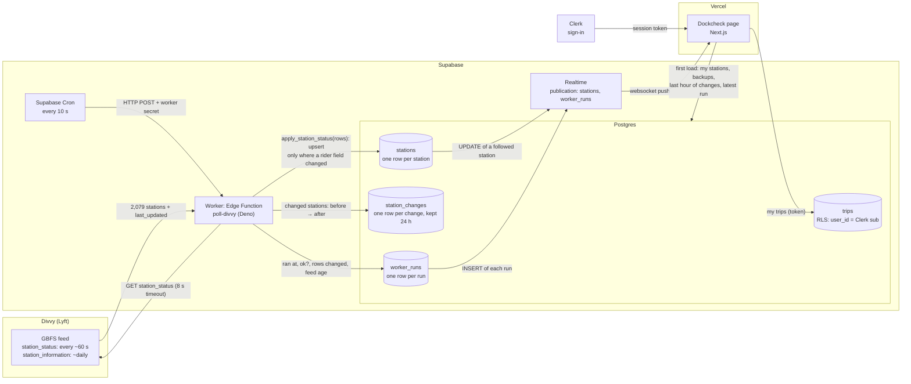

# Step 3: the data flow, planned before any code

Drawn with the agent before the worker, the schema or the page existed. Built from what
Step 1 measured: the feed refreshes every ~60 s, `last_reported` is a heartbeat, ~153
of 2,079 stations change in six minutes, and 902 "lightweight" stations rarely report.

## The chart

## Ask your agent: "Walk me through the chart: what each part sends to the next, and what would break if one part changed it."

| From → to | What it sends | What breaks if it changes |
|---|---|---|
| **Cron → worker** | An HTTP POST every 10 s with a secret header (the secret lives in Supabase Vault, not in code) | Cron stops: no new runs. The page notices **by itself** because the last run gets older (stale). Wrong secret: the worker refuses, logs it, and every call is a failed run (down). |
| **Divvy → worker** | `station_status.json`: `last_updated`, then per station `station_id`, bike/e-bike/dock counts, flags, `last_reported` | Divvy is slow or down: the worker times out at 8 s and records a **failed run**, so the page shows *down* with the last good numbers. Divvy renames a field (GBFS v2/v3 does): the worker's validation rejects the row and records a failed run instead of saving zeros. |
| **Worker → `stations`** | Normalized rows to `apply_station_status`, which upserts **only where a rider field is distinct** from what's saved | Diff on `last_reported` instead: ~8× more writes, and Realtime messages to every open page. Drop the "only if distinct" guard: every station rewritten every minute, and the free Realtime quota is gone in hours. |
| **Worker → `station_changes`** | For each changed station: old and new bikes / e-bikes / docks, and when | Stop writing it: the live numbers still work, but trends like "−4 bikes in 15 min" go blank. |
| **Worker → `worker_runs`** | `ran_at`, `ok`, `rows_changed`, `stations_seen`, `feed_updated_at`, `duration_ms`, `error` | Stop writing it: the page can't tell fresh from stale from down. **This table is the page's freshness clock.** |
| **`stations` → Realtime → page** | An UPDATE event per changed row, **filtered to the stations this person follows** | Table not in the publication, `select` not granted, or no RLS policy: **the page gets nothing and shows no error.** The page also re-reads on reconnect so a dropped socket can't leave it silently behind. |
| **`worker_runs` → Realtime → page** | An INSERT per run | Same three requirements. If runs stop arriving, the page's own clock turns *stale* after ~3 missed runs, because silence can't send a message. |
| **Clerk → page → `trips`** | Clerk session token (`sub` = user id). The page reads and writes trips with it. | Token not sent: RLS returns no trips (looks like "you follow nothing"). |

## Decisions this chart commits to

1. **Two clocks, both shown.** *Checked 6 s ago* is when our worker last ran (from
   `worker_runs`). *Divvy updated 40 s ago* is when Divvy last published (`feed_updated_at`).
   They fail differently, so the page shows the right message for each.
2. **Skip work when nothing is new.** If the feed's `last_updated` equals the last
   successful run's, the worker records a run with 0 changes and stops. About 5 of
   every 6 runs end here, which is the honest result of polling every 10 s against a
   60 s feed.
3. **Diff in the database, not the worker.** The worker sends all rows to one SQL
   function, and Postgres updates only rows where a rider field `IS DISTINCT FROM` what's
   saved. Reading 2,079 rows back into the worker every minute would be about 6 GB of
   egress a month, over the free 5 GB.
4. **`reported_at` is written only with a real change**, or when a station crosses into
   or out of *silent* (no report for 60 min). Silence is a fact the page needs; a
   heartbeat isn't.
5. **The page counts silence itself.** A clock ticks each second on the page. Without any
   message arriving, it turns:

   | State | When | What the person sees |
   |---|---|---|
   | **Loading** | Before the first read | Placeholders shaped like the trip cards |
   | **Fresh** | Last run ok and < 35 s old, Divvy data < 3 min old | Numbers, *Live · checked 6 s ago* |
   | **Stale** | Last ok run > 35 s old (3 missed runs), or Divvy hasn't published in 3 min | Numbers dimmed: *Last checked 2 min ago, these may be out of date* |
   | **Down** | The latest run failed | *Can't reach Divvy right now. Showing numbers from 8:41 PM* |
   | **Reconnecting** | The browser lost the live connection | *Reconnecting…*, then a full re-read |

   Per station too: *closed* (not renting / not returning) and *not reporting since
   5:10 PM* (silent).
6. **Realtime only for what this person follows**, and paused while the tab is hidden,
   to stay inside the free message quota.
7. **The worker writes with the secret key** that Supabase gives it on its servers.
   Signed-in people can **read** `stations` and `worker_runs`; nobody but the worker
   writes them. `trips` is per person with RLS.

## Free-tier budget

| Service | Limit | Dockcheck |
|---|---|---|
| Edge Function calls | 500,000 / month | 8,640 / day ≈ 259,000 / month |
| Realtime messages | 2,000,000 / month | Per open, visible page: ~6 run events + a few station events a minute |
| Database | 500 MB | `station_changes` ≈ 35,000 rows/day, deleted after 24 h by a second cron job |
| Egress | 5 GB / month | The worker sends rows in and gets counts back; the page reads only its stations |
