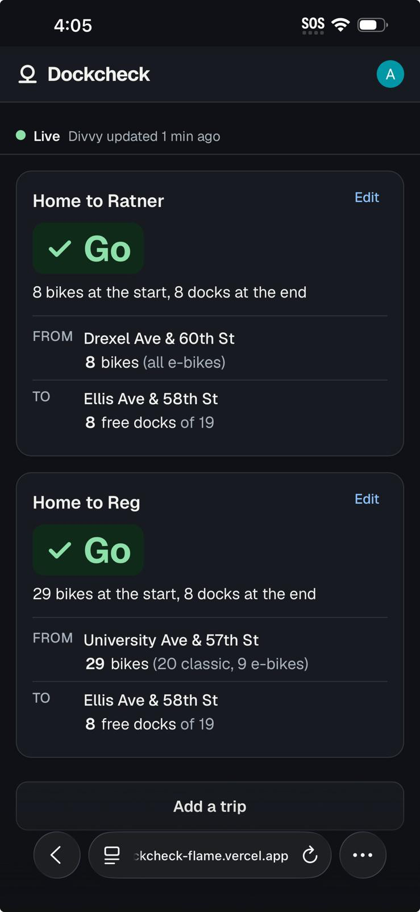

# Step 6: the page

Live at **https://dockcheck-flame.vercel.app** (Vercel Hobby). Next.js 16 + Tailwind,
Clerk for sign-in, Supabase for data and Realtime.

*Tue Nov 3, 4:05 PM, on the author's phone. Both trips say **Go**. Drexel Ave & 60th St
shows 8 bikes, **all e-bikes**, which is why the split is on the card (e-bikes cost extra).*

## Ask your agent: "How does the page stay live, and how does it know when it isn't?"

**Staying live.** On load the page reads the person's trips (RLS: only their own), the
stations on them, the nearest dock stations to each end (`dockcheck_nearby`), and the
latest run. Then it opens **one Realtime channel** with two filters:

| Listens to | Filter | Why the filter |
|---|---|---|
| `stations` UPDATE | `station_id=in.(…)`: only this person's trip ends, their backups, and suggested backups (≤ 100) | 2,079 stations change all day; a person cares about ~20 |
| `worker_runs` INSERT | `feed_unchanged=eq.false`: only runs that changed something or **failed** | Cuts Realtime messages by 5/6 (83.4% of runs find nothing new). The review measured ~260,000 messages a month per open page otherwise, against 2 M free |

The Clerk token goes to Realtime on connect and on every heartbeat, so Clerk's 60 s tokens
never expire the socket. The channel is **dropped while the tab is hidden** and reopened
with a full re-read when it's visible again. After any reconnect the page re-reads
everything, so a dropped socket can't leave it quietly behind.

**Knowing when it isn't.** Silence can't send a message, so the page keeps its own clock
(`lib/freshness.ts`, tested):

| State | When | The bar says | Cards |
|---|---|---|---|
| **Loading** | before the first read | *Getting live numbers…* | placeholders shaped like cards |
| **Live** | Divvy's newest applied feed is < 3 min old | *Live · Divvy updated 40 s ago* | normal |
| **Stale** | 3 min without a newer feed | *Divvy hasn't published since 3:58 PM* **or** *Our checker stopped at 3:58 PM*, then *Numbers may be out of date.* | dimmed |
| **Down** | the latest run failed | *Can't reach Divvy right now* **or** *Our checker hit a problem*, then *Showing numbers from 3:58 PM.* | dimmed |
| **Reconnecting** | the socket dropped | *Reconnecting… Showing numbers from 3:58 PM.* | dimmed |

To tell the two kinds of *Stale* apart, the page looks up the very latest run (of any kind)
once a minute, but only while stale. A recent ok run means Divvy stopped publishing; no
recent run means our checker stopped.

One worker change made *Down → Live* instant. After a failed run, the next run applies
the feed even if it's unchanged, so the recovery is a run the page hears about.

## The card: one big word, one number

`lib/verdict.ts` (tested) turns two stations into one answer. The word carries the
meaning, and color and icon repeat it:

| Word | When | The one number |
|---|---|---|
| **Go** ✓ | both ends have more than 2 | *8 bikes at the start, 8 docks at the end* |
| **Tight** ! | 1–2 bikes at the start or docks at the end | *Only 1 bike at University Ave & 57th St* |
| **No bikes** / **No docks** ✕ | 0 at that end (start checked first: you can't even leave) | *Ellis Ave & 58th St is full: 0 docks* |
| **Closed** ✕ | not renting / not taking returns | *… isn't taking bikes back right now* |
| **Unsure** ? | the station isn't reporting | *… hasn't reported since 5:10 PM* |

When there's a problem, **backups** appear under the card, each with its reason in words:
the person's own backups first (*Your backup*, shown even if they can't help, so they
don't vanish), then the nearest stations that **actually solve it** (*Nearest with docks*)
and the walk (*3 min walk*). Nearest isn't enough: at midnight the three stations nearest
57th St all had 0 bikes.

A number that just changed **glows for 2.5 s**. With reduced motion it gets a still
outline for the same time instead.

## Design rules (AGENTS.md), checked

| Rule | How |
|---|---|
| Glanceable, phone-first | One column, `max-w-md`; the word is 36 px; the answer is two lines |
| Status never color alone | Word + icon shape + color. Contrast: `scripts/contrast.mjs` checks all 32 pairs in light and dark against WCAG AA, reading the colors from `globals.css`. All pass (lowest text pair 6.95:1) |
| No surprise UI | Backups appear only with a heading and a reason; the example on the signed-out page is labeled *Example*; the 8-trip limit says why |
| Remember what people tell you | Trips, names and chosen backups are saved per person (RLS) |
| Motion explains change | The 2.5 s glow; respects reduced motion |
| Every control does something | *Edit* opens that trip; *Delete* asks once (*Yes, delete it* / *Keep it*) |
| Forms | One column, a real label and hint on every field, errors under the field and focused, typed values kept. A duplicate name says *You already have a trip called "…"* |
| Keyboard | Station search is a WAI-ARIA combobox (arrows, Enter, Escape); visible focus ring everywhere; skip link |

## Tests

`npm test` runs **35 tests**: 15 for the page logic (`lib/`) and 20 for the worker.
`npm run build` type-checks everything; `npm run lint` is clean.

## Decisions made while building

- **`cacheComponents` / `partialPrefetching` off** (`next.config.ts`). They keep visited
  pages alive hidden, so *Add a trip* would reopen with the last trip typed. Same lesson
  as Assignment 4.
- **Dock stations only** in the picker. The 902 lightweight e-bike lock-ups have no docks
  to return to, and the hint says so.
- **8 trips at most**: 8 trips × 2 ends × 4 nearby + the ends stays under Realtime's 100-id
  filter.
